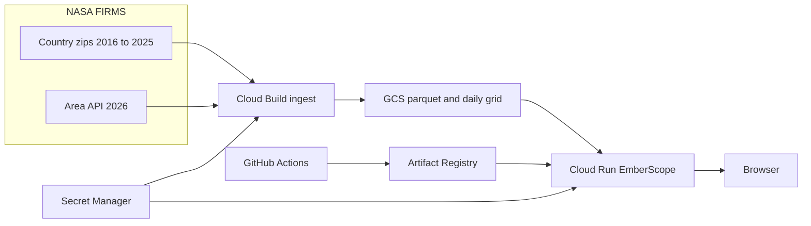
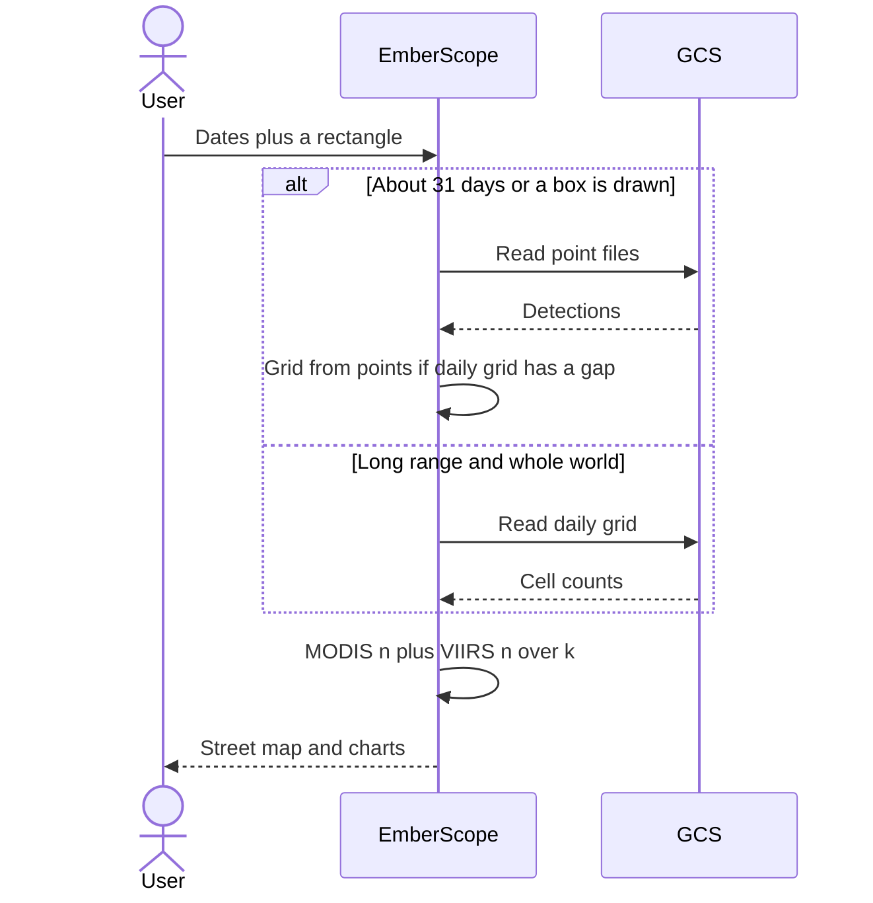
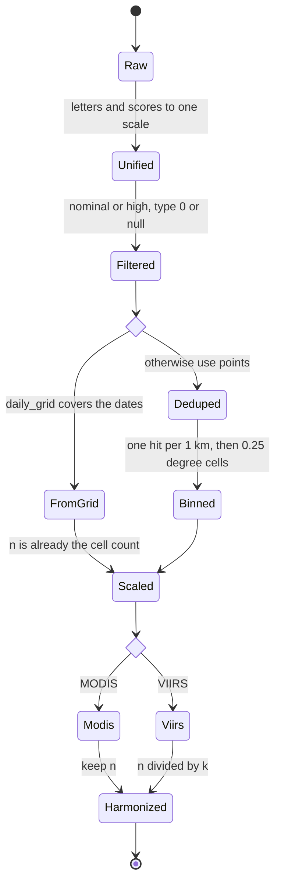

# EmberScope

EmberScope maps NASA active-fire detections from MODIS and VIIRS on one scale. MODIS is the reference. VIIRS sees smaller fires and reports more hotspots, so its counts are divided by a scale factor **k** before they are drawn.

The app is a Streamlit dashboard with a pydeck map. It ships with a 100,000-row FIRMS sample from 1 September 2026 through 8 November 2026 (about 85% VIIRS SNPP, about 15% MODIS Terra/Aqua). A **Live (last 24h)** mode can load the latest global day from the NASA FIRMS area API.

The science lives in `harmonize.py`. It follows `Submission_Project.ipynb`, which is unchanged.

Handoff for the next person or agent: [AGENTS.md](AGENTS.md). Diagrams: [docs/ARCHITECTURE.md](docs/ARCHITECTURE.md). Reload the archive: [ingest/README.md](ingest/README.md).

Live service: https://emberscope-156735151789.us-central1.run.app

## Tech stack

| Layer | Technology | Version / note |
| --- | --- | --- |
| Data sources | NASA FIRMS country zips and area API | MODIS and VIIRS S-NPP. Live app also calls `VIIRS_SNPP_NRT` and `MODIS_NRT` |
| Ingestion | Python, Cloud Build | `ingest/requirements.txt`: pandas 2.2.3, pyarrow 18.1.0, numpy 2.1.3, requests 2.32.3, google-cloud-storage 2.18.2. Python 3.11 |
| Storage | Google Cloud Storage parquet | Bucket `emberscope-data-156735151789`. Hive layout plus `agg/daily_grid.parquet` |
| Processing | `harmonize.py`, `archive.py` | pandas 3.1.1, numpy 2.4.6, pyarrow 26.0.1. k = 5.190318 unless `HARMONIZE_K` is set |
| App | Streamlit | 1.67.0 on Python 3.11 |
| Visualization | pydeck, folium, Plotly | pydeck 0.9.3, folium 1.0.0, streamlit-folium 0.27.4, plotly 7.1.0. CARTO Voyager basemap. OpenStreetMap tiles for the draw box |
| Hosting | Cloud Run, Artifact Registry, Cloud Build | Service `emberscope`, 4 GiB, 2 CPU, timeout 300s, max 2 instances, `us-central1` |
| CI/CD | GitHub Actions | `.github/workflows/deploy.yml` blue-green. Not switched on until Workload Identity variables exist |
| Security | Secret Manager | `FIRMS_MAP_KEY` only. Never committed |
| GCS client in the app | gcsfs, google-cloud-storage | gcsfs 2026.10.1, google-cloud-storage 3.17.1 |
| Testing | unittest | `test_harmonize.py`, `test_archive.py`, `test_dockerfile.py` |
| Planned | Angular, Go, Kubernetes | Not in this repo yet |

## Flow







## What the map shows

The basemap is CARTO Voyager, a light street map. No Mapbox token. Scroll and the +/- buttons zoom.

**Raw detections.** One point per satellite pixel. MODIS is blue (`#0072B2`) and VIIRS is orange (`#E69F00`), the Okabe-Ito pair. Hover or click a point for latitude, longitude, date and time in UTC, satellite, instrument, confidence, FRP, brightness, and day or night.

**Harmonized 0.25° grid.** Cells are colored with viridis (fewer to more). On the bundled sample, a day with VIIRS uses **VIIRS ÷ k**, and a day with only MODIS shows the MODIS count. On the 10-year archive, each cell is **MODIS n + VIIRS n / k**. FRP is summed and is not divided by k.

Drag a rectangle on the street map under the legend to limit the region, or type south/north/west/east in the sidebar. **Clear region** removes the box. The FRP slider is one range. Its ends stay at the min and max for the current dates and sensors, so lowering the max does not trap the handle.

**Archive dates.** With `DATA_BUCKET` or `DATA_PATH` set, the date control runs from 15 November 2016 through today and opens on the last 7 days the manifest says are loaded. Individual points load when that range is 31 days or less, or when any rectangle is drawn. A long range with no rectangle uses the daily grid only. The map draws at most 50,000 points and says when it sampled.

The sidebar date range chooses which days are included. The slider under the title chooses which one day the map draws. Satellite, sensor, confidence, FRP, and day/night filters apply before the grid is built.

## Harmonization method

Same steps as the notebook:

1. Put both sensors on one table.
2. Map confidence to low / nominal / high.
3. Keep nominal and high confidence, and vegetation fires (`type == 0`). This sample has no `type` column, so that filter does not remove anything in the bundled file. Live MODIS rows that include `type` are filtered.
4. Keep one detection per sensor per day inside a 0.01° box (about 1 km).
5. Count hotspots and sum FRP in 0.25° cells. **k scales the counts, not the FRP.**
6. `k = (VIIRS hotspots) / (MODIS hotspots)` on the overlap. Adjusted VIIRS = VIIRS / k.

On the bundled sample, after steps 3 and 4, that ratio is **73,334 / 14,129 = 5.190**. The app uses `k = 5.190318`. The Brazil 2012–2025 archive that produced the notebook's original k is not in this repo. Set `HARMONIZE_K` to that notebook value when you have it. Live data uses the same k. One near real-time day is too short to refit the ratio.

### Limits

- One global k drifts over time and can slightly underestimate recent peak months.
- MODIS is the reference. A small error means scaled VIIRS is close to MODIS, not that every real fire was counted.
- Terra flew before Aqua joined in 2002, so the earliest MODIS years run low. This demo's sample is 2026.
- The notebook checks per-continent k on a single day (15 September 2026). This app uses one global k.
- The bundled file is a 100,000-row sample, not the full global archive. Some days in the range are missing, and the last few days are almost all MODIS.
- Live mode is the latest FIRMS near real-time day (VIIRS SNPP NRT and MODIS NRT). Those detections can be revised.

## Data refresh

From `ingest/` (not the repo root):

```bash
gcloud builds submit \
  --config cloudbuild.yaml \
  --substitutions _DATA_BUCKET=emberscope-data-156735151789 \
  --region us-central1 \
  .
```

`_FORCE=1` rebuilds finished years. `_REFRESH_API=1` refetches the current year from the FIRMS API. Details, the offshore-gap caveat, and the rate limit are in [ingest/README.md](ingest/README.md). The ingest tree is not copied into the Cloud Run app image.

## Archive in Cloud Storage

Set one of these. `DATA_PATH` wins when both are set, which is how the tests run.

```bash
export DATA_BUCKET="emberscope-data-156735151789"   # Cloud Run
export DATA_PATH="/path/to/local-archive"           # laptop or tests; file:// is accepted
```

Expected layout:

```text
firms/source=modis/year=YYYY/month=MM/part-*.parquet
firms/source=viirs/year=YYYY/month=MM/part-*.parquet
agg/daily_grid.parquet
```

Point columns include `latitude`, `longitude`, `acq_date`, `acq_time` (HHMM), `satellite`, `instrument`, `confidence` (`low` / `nominal` / `high`), `frp`, `brightness`, `daynight`, `type`, and `source`. The daily grid columns are `acq_date`, `lat_bin`, `lon_bin` (0.25° lower-left), `source`, `n`, and `frp_sum`. `n` is nominal+high and type 0 or null, before the 1 km dedupe. Optional `manifest.json` in the bucket root tells the app what is loaded, for example `{"agg_start":"2016-11-15","agg_end":"2025-12-31","points_start":"2016-11-15","points_end":"2026-11-15"}`. Dates the grid does not cover are counted from detections. Reads go through PyArrow datasets and, on GCS, `gcsfs` with Application Default Credentials. Results are cached for 10 minutes.

A long range is summed to one row per cell so a decade does not land in memory as every day. Point reads stop after 250,000 rows. If the bucket cannot be read, the page says so. Unset `DATA_BUCKET` to return to `app_data.csv`.

Cloud Run needs more memory once the archive is attached. Update the live service before the demo:

```bash
gcloud run services update emberscope \
  --region us-central1 \
  --memory 4Gi \
  --cpu 2 \
  --timeout 300 \
  --update-env-vars DATA_BUCKET=emberscope-data-156735151789
```

The runtime service account needs `roles/storage.objectViewer` on that bucket. 1 GiB is enough for the bundled sample and is tight for a month of global points.

Cloud Run runs the container defined by the `Dockerfile`. Google Cloud Build builds that image. You do not install Docker on a laptop to deploy.

| File | Role |
| --- | --- |
| `app.py` | EmberScope UI |
| `harmonize.py` | Harmonization, importable, no Colab or Drive |
| `app_data.csv` | Bundled FIRMS sample |
| `Submission_Project.ipynb` | Original notebook, left as the team wrote it |
| `Dockerfile` | Image Cloud Build uses. Keep this file. |
| `.github/workflows/deploy.yml` | Blue-green deploy and rollback |

## Run locally

Python 3.11 or 3.12. From this folder:

```bash
python3 -m venv .venv
source .venv/bin/activate
pip install -r requirements.txt
streamlit run app.py
```

Open the URL Streamlit prints (usually http://localhost:8501).

Optional environment variables:

```bash
export FIRMS_MAP_KEY="your-firms-map-key"   # enables Live (last 24h)
export HARMONIZE_K="5.19"                   # optional override of k
export DATA_BUCKET="emberscope-data-156735151789"  # 10-year archive
export DATA_PATH="/path/to/local-archive"   # optional local stand-in for the bucket
export EMBER_DATA_URI="gs://bucket/one-file.parquet"  # optional single file, bundled mode only
```

`EMBER_DATA_URI` may be a local `.csv` or `.parquet`, or a `gs://` path. A detection file has `latitude` / `longitude`. A grid file has `sensor`, `date`, `cell_lat`, `cell_lon`, and `n_hotspots` (the output of `aggregate`). A `gs://` read uses Application Default Credentials. If the read fails, the app shows a message and uses `app_data.csv`.

Live mode calls:

```text
https://firms.modaps.eosdis.nasa.gov/api/area/csv/MAP_KEY/VIIRS_SNPP_NRT/world/1
https://firms.modaps.eosdis.nasa.gov/api/area/csv/MAP_KEY/MODIS_NRT/world/1
```

The map key stays in the environment. It is not written into the page or the error text. If the key is missing or FIRMS does not answer, the app explains that and keeps showing the bundled sample.

Check the harmonization math with:

```bash
python3 -m unittest test_harmonize.py
```

## Deploy to Cloud Run

The service name is **emberscope**. Deploy from this folder, the one that contains the `Dockerfile`. Cloud Build builds the image. Docker does not need to be installed on your Mac.

You already ran `gcloud auth login`. Confirm the account, then pick the project you smoke-tested (or create one and link billing in the console if API enable says billing is required):

```bash
gcloud auth list
export PROJECT_ID="your-gcp-project-id"
export REGION="us-central1"
export FIRMS_MAP_KEY="paste-your-firms-map-key"

gcloud config set project "$PROJECT_ID"
```

Enable the APIs the deploy uses:

```bash
gcloud services enable \
  run.googleapis.com \
  cloudbuild.googleapis.com \
  artifactregistry.googleapis.com \
  secretmanager.googleapis.com
```

On a fresh project, the first `--source` deploy fails with `403 storage.objects.get` for the default Compute Engine service account. Grant it Cloud Run's builder role **before** the first deploy:

```bash
PROJECT_NUMBER=$(gcloud projects describe "$PROJECT_ID" --format='value(projectNumber)')
COMPUTE_SA="${PROJECT_NUMBER}-compute@developer.gserviceaccount.com"

gcloud projects add-iam-policy-binding "$PROJECT_ID" \
  --member="serviceAccount:${COMPUTE_SA}" \
  --role="roles/run.builder"
```

Store the FIRMS key in Secret Manager. `printf` does not add a newline to the secret.

```bash
printf '%s' "$FIRMS_MAP_KEY" | gcloud secrets create FIRMS_MAP_KEY \
  --data-file=- \
  --replication-policy=automatic
```

If the secret already exists, add a new version instead of creating it again:

```bash
printf '%s' "$FIRMS_MAP_KEY" | gcloud secrets versions add FIRMS_MAP_KEY --data-file=-
```

Let the Cloud Run runtime service account read the secret. On a default project that account is the same Compute Engine account:

```bash
gcloud secrets add-iam-policy-binding FIRMS_MAP_KEY \
  --member="serviceAccount:${COMPUTE_SA}" \
  --role="roles/secretmanager.secretAccessor"
```

### Budget alert

In the Google Cloud console open **Billing → Budgets & alerts → Create budget**. Scope it to this project. A small demo budget such as 20 USD is enough: the service below is capped at 2 instances. With the archive attached, give the service 4 GiB and 2 CPUs. Set email alerts at 50%, 90%, and 100%, and send them to the team.

### Deploy

Keep the `Dockerfile` in this folder. `gcloud run deploy --source .` uploads the folder and Cloud Build builds that Dockerfile. The first build takes several minutes. The command prints a URL when it finishes.

```bash
gcloud run deploy emberscope \
  --source . \
  --region us-central1 \
  --allow-unauthenticated \
  --memory 4Gi \
  --cpu 2 \
  --timeout 300 \
  --max-instances 2 \
  --set-env-vars DATA_BUCKET=emberscope-data-156735151789 \
  --set-secrets FIRMS_MAP_KEY=FIRMS_MAP_KEY:latest
```

`--memory 4Gi` and `--cpu 2` leave room for a month of points. `--max-instances 2` caps the bill. The container listens on the `PORT` Cloud Run sets (8080). The bundled sample alone fits in 1 GiB. Use 4 GiB when `DATA_BUCKET` is set.

Open the service:

```bash
gcloud run services describe emberscope \
  --region "$REGION" \
  --format='value(status.url)'
```

During the demo window you can keep one instance warm, then scale back to zero afterward:

```bash
gcloud run services update emberscope --region "$REGION" --min-instances 1
gcloud run services update emberscope --region "$REGION" --min-instances 0
```

### If the deploy fails

**Buildpacks.** An error that mentions Google buildpacks means Cloud Run did not see the Dockerfile. Run the command from this folder and leave `Dockerfile` in the project root. Buildpacks were tried on this Streamlit app and failed. The Dockerfile (`python:3.11-slim`, `pip install -r requirements.txt`, Streamlit on `$PORT`) is the build that deployed.

**403 storage.objects.get** for `PROJECT_NUMBER-compute@developer.gserviceaccount.com`. Run the `roles/run.builder` binding above, wait a minute, and deploy again. That was the fix on a fresh project in `us-central1`.

**Secret permission.** If the revision starts and immediately says it cannot access `FIRMS_MAP_KEY`, rerun the `secretAccessor` binding for the runtime service account. The key itself stays in Secret Manager. It is not a GitHub secret and it is not in the repo.

**Live mode in the cloud.** The deployed service reads `FIRMS_MAP_KEY` from the secret. Locally, export the same variable before `streamlit run`. A missing key does not crash the app. The page explains it and shows the bundled sample.

## Blue-green releases

Pushes to `main` run `.github/workflows/deploy.yml` when the Google Cloud repository variables are set. The workflow:

1. Builds the Dockerfile with Cloud Build and pushes it to Artifact Registry as `REGION-docker.pkg.dev/PROJECT/emberscope/emberscope:COMMIT_SHA`.
2. Creates a new Cloud Run revision of **emberscope** with **0% traffic** and a preview tag such as `rabc12341` (a letter, the short commit SHA, and the run attempt). Cloud Run tags have to start with a letter, and a commit SHA can start with a digit.
3. Requests `https://TAG---emberscope-....run.app/_stcore/health` and the main page. Both must return HTTP 200. It retries for about three minutes so a cold start can finish.
4. Sends 100% of traffic to that revision only after both checks pass (`gcloud run services update-traffic emberscope --to-revisions REVISION=100`).
5. If a check fails, the job fails and the previous revision keeps 100% of traffic. The new revision stays up only on its preview URL so you can look at it.

Cloud Run will not create the very first revision with `--no-traffic`. The first deploy serves traffic while it is created, the same smoke test runs, and a failed first smoke test deletes that new service so a broken first launch is not left online.

The revision name looks like `emberscope-rabc12341`. List them with:

```bash
gcloud run revisions list --service emberscope --region "$REGION"
```

### Roll back

In GitHub: **Actions → Deploy EmberScope → Run workflow**, and paste the revision name that should receive traffic.

Or from your laptop:

```bash
gcloud run services update-traffic emberscope \
  --region "$REGION" \
  --to-revisions REVISION_NAME=100
```

Example: `--to-revisions emberscope-rabc12341=100`.

Until the three repository variables below are set, a push to `main` does not deploy. The workflow prints `Skipping Cloud Run deploy` and finishes successfully. Set the variables only after Workload Identity Federation is in place. An empty configuration is a skip. A wrong configuration is a failed deploy, and traffic stays on the old revision.

The laptop command in the previous section is the direct deploy (Cloud Build from your machine). It does not do the zero-traffic smoke test. Use it for the first launch. Use the GitHub workflow once the variables exist.

## GitHub Actions and Workload Identity

No JSON key is stored in GitHub. The workflow uses Workload Identity Federation. The FIRMS key stays in Secret Manager. The workflow passes it with `--set-secrets FIRMS_MAP_KEY=FIRMS_MAP_KEY:latest`.

Create a pool, a provider locked to this repository, and a deployer service account. `PROJECT_ID` and `PROJECT_NUMBER` are the ones from the deploy section.

```bash
gcloud iam workload-identity-pools create github \
  --location=global \
  --display-name="GitHub Actions"

gcloud iam workload-identity-pools providers create-oidc github \
  --location=global \
  --workload-identity-pool=github \
  --display-name="GitHub" \
  --issuer-uri="https://token.actions.githubusercontent.com" \
  --attribute-mapping="google.subject=assertion.sub,attribute.repository=assertion.repository" \
  --attribute-condition="assertion.repository=='carbon9634-max/nasa-hotspot-explorer'"

gcloud iam service-accounts create emberscope-deployer \
  --display-name="EmberScope GitHub deployer"

DEPLOYER="emberscope-deployer@${PROJECT_ID}.iam.gserviceaccount.com"

gcloud iam service-accounts add-iam-policy-binding "$DEPLOYER" \
  --role="roles/iam.workloadIdentityUser" \
  --member="principalSet://iam.googleapis.com/projects/${PROJECT_NUMBER}/locations/global/workloadIdentityPools/github/attribute.repository/carbon9634-max/nasa-hotspot-explorer"

for role in roles/run.admin roles/cloudbuild.builds.editor roles/artifactregistry.admin roles/storage.admin roles/serviceusage.serviceUsageConsumer; do
  gcloud projects add-iam-policy-binding "$PROJECT_ID" \
    --member="serviceAccount:${DEPLOYER}" \
    --role="$role"
done

gcloud iam service-accounts add-iam-policy-binding "$COMPUTE_SA" \
  --member="serviceAccount:${DEPLOYER}" \
  --role="roles/iam.serviceAccountUser"
```

The Compute Engine account still needs `roles/run.builder` (the 403 fix above) and `roles/secretmanager.secretAccessor`.

In the GitHub repo open **Settings → Secrets and variables → Actions → Variables** and add:

| Variable | Value |
| --- | --- |
| `GCP_PROJECT_ID` | the project id |
| `GCP_WORKLOAD_IDENTITY_PROVIDER` | `projects/PROJECT_NUMBER/locations/global/workloadIdentityPools/github/providers/github` |
| `GCP_SERVICE_ACCOUNT` | `emberscope-deployer@PROJECT_ID.iam.gserviceaccount.com` |
| `GCP_REGION` | `us-central1` (optional; this is the default) |
| `FIRMS_SECRET_NAME` | `FIRMS_MAP_KEY` (optional; this is the default) |

These are variables, not secrets. They are resource names. The map key never goes in GitHub.

Push to `main` to deploy. To roll back, run the workflow manually and pass the revision name.

## Environment variables

| Variable | Purpose |
| --- | --- |
| `PORT` | Port Streamlit listens on. Cloud Run sets it. The image defaults to 8080. |
| `FIRMS_MAP_KEY` | NASA FIRMS map key for Live mode. On Cloud Run this comes from Secret Manager. |
| `HARMONIZE_K` | Optional positive number. Replaces the bundled k of 5.190318. |
| `DATA_BUCKET` | GCS bucket with `firms/` and `agg/daily_grid.parquet`. Unset uses `app_data.csv`. |
| `DATA_PATH` | Local archive with the same layout. Overrides `DATA_BUCKET`. `file://` is accepted. |
| `EMBER_DATA_URI` | Optional single CSV or Parquet, including `gs://`, for the bundled path. |
