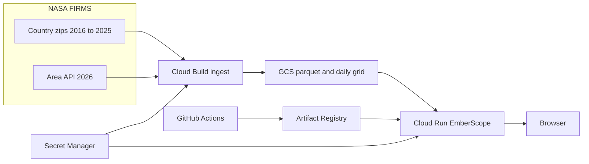
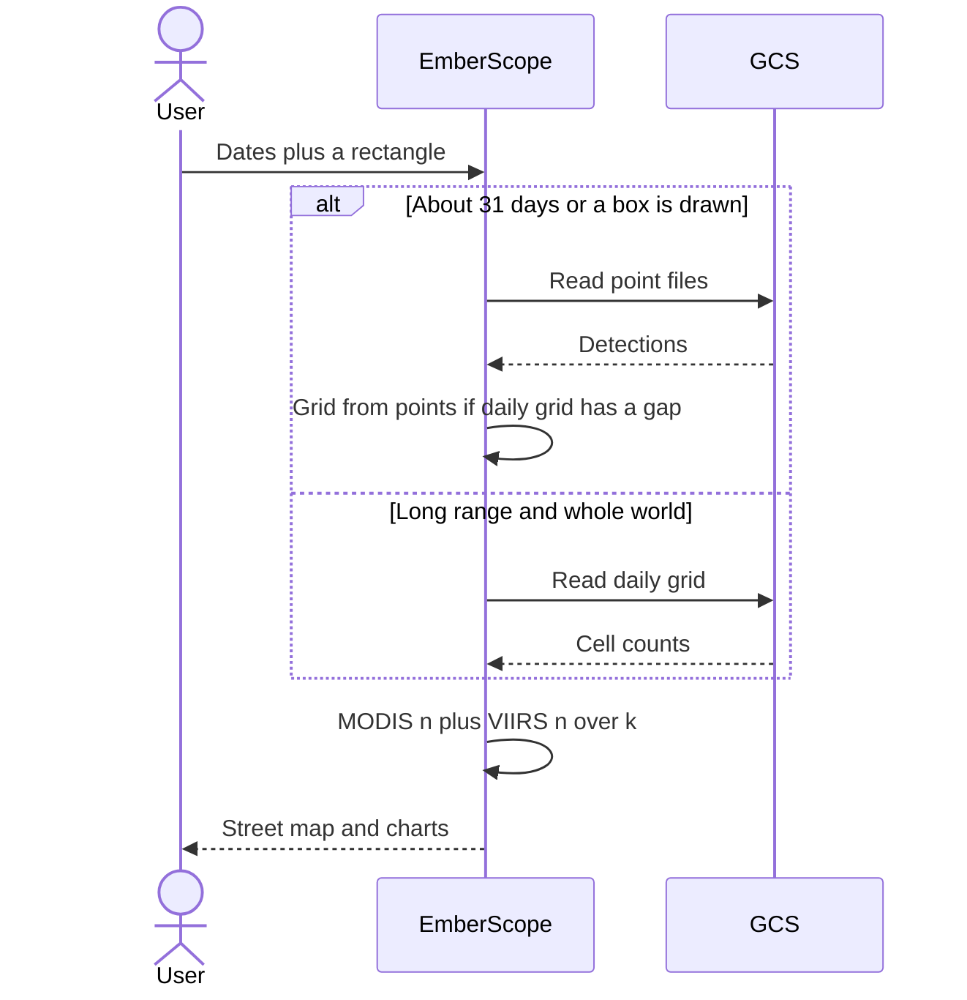
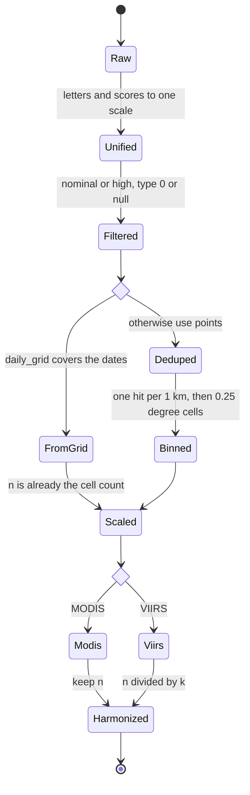

# EmberScope architecture

How a fire detection gets from NASA to the map. Short labels on purpose.

Live app: https://emberscope-156735151789.us-central1.run.app

See also [AGENTS.md](../AGENTS.md) and [ingest/README.md](../ingest/README.md).

## System

The ingest job is manual today (`gcloud builds submit` from `ingest/`). GitHub Actions blue-green deploy is `.github/workflows/deploy.yml`. Workload Identity pool `github` and provider `nasa-hotspot-explorer` are limited to this repo on `refs/heads/main`. A laptop can still deploy from the repo root with `gcloud run deploy --source .`.

## A person picks a place and a week

## Harmonization

`k` is 5.190 on the bundled sample. Set `HARMONIZE_K` to replace it. The bundled-sample path in `harmonize.py` also splices sensors on 2012-02-01 so the same fire is not added twice. The archive map adds MODIS n and VIIRS n / k in each cell.
